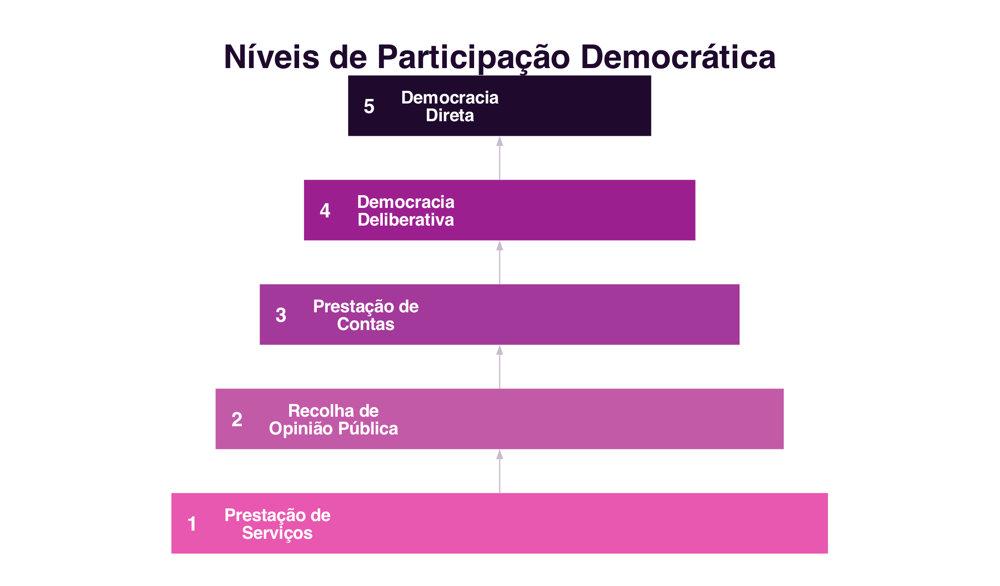
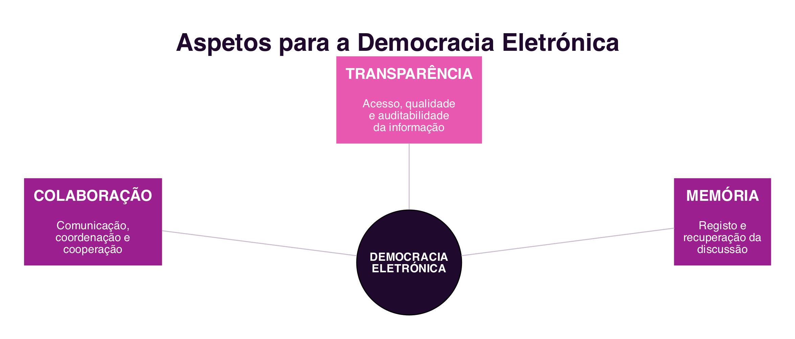

```{=html}
<div class="hero hero-chapter" style="background-image: linear-gradient(to top, rgba(31,10,46,0.88) 0%, rgba(31,10,46,0.6) 20%, rgba(31,10,46,0.15) 45%, rgba(31,10,46,0) 65%), url('../assets/images/heroes/cap07.jpg');">
  <div class="hero-badge">Capítulo 7</div>
  <h1>Democracia Eletrónica</h1>
</div>
```

## Introdução {#sec-07-intro .unnumbered}

O capítulo anterior mostrou como os Ambientes Virtuais Colaborativos
recriam, no espaço digital, formas de identidade, interação e presença
próprias do mundo real (@sec-06-identidade). Este capítulo aplica uma
lógica semelhante a um domínio distinto: a participação política. As
mesmas tecnologias de interação social que ligam comunidades virtuais
podem também mediar a relação entre cidadãos e governo, mas fazê-lo não
é automático: a tecnologia, por si só, não gera mais democracia. O
que determina o resultado é o **nível de participação** desenhado no
sistema.

## Governo Eletrónico e Democracia Eletrónica {#sec-07-governo-eletronico}

As tecnologias de interação social têm possibilitado novas formas de
expressão e mobilização política dos cidadãos. Um caso histórico
ilustra bem este potencial: em 2009, durante os protestos que se
seguiram à reeleição contestada do presidente do Irão, os
manifestantes contornaram a censura estatal e usaram o `Twitter` para
relatar, em tempo real, o que acontecia no país, numa altura em que o
governo tinha bloqueado o acesso às redes sociais [@AraujoEtAl2011].
Este episódio tornou-se uma referência sobre o potencial político das
redes sociais, embora, como se verá adiante, a tecnologia sozinha não
seja garantia de participação democrática efetiva.

É importante distinguir dois conceitos próximos, mas diferentes:

- O **Governo Eletrónico** (e-Gov) designa toda a prestação de serviços
  e informações, de forma eletrónica, do governo para os cidadãos, as
  empresas e outros níveis de governo, 24 horas por dia, sete dias por
  semana [@AraujoEtAl2011]. É, essencialmente, uma questão de eficiência
  administrativa.
- A **Democracia Eletrónica** (e-Democracia) vai além: designa o
  conjunto de discursos, teorizações e experimentações que empregam as
  tecnologias de informação e comunicação para mediar relações
  políticas, tendo em vista a participação democrática nos sistemas
  políticos contemporâneos [@AraujoEtAl2011]. Não trata apenas de
  melhorar a qualidade dos serviços públicos, mas de criar novos
  processos e novas relações entre governantes e governados.

A distinção importa porque um portal de serviços públicos eficiente,
por si só, não é Democracia Eletrónica: pode facilitar a vida do
cidadão sem lhe dar qualquer participação nas decisões políticas.

## Níveis de Participação Democrática {#sec-07-niveis}

Para desenvolver soluções de apoio à Democracia Eletrónica, é preciso
antes definir o nível de participação e interação que se deseja
alcançar entre governo e cidadãos. O **Modelo de Níveis de Participação
Democrática** [@Gomes2005; @AraujoEtAl2011], que Gomes apresenta como
cinco graus de democracia digital, organiza-se em cinco níveis (@fig-07-niveis):

{#fig-07-niveis}

1. **Prestação de Serviços**: disponibilização de informações e
   serviços públicos. A interação é predominantemente de mão única: o
   governo disponibiliza, o cidadão consome. Estes serviços melhoram a
   eficiência, mas não conferem participação política ao cidadão.
2. **Recolha de Opinião Pública**: o governo usa as TIC como canal de
   consulta, mas continua a ser uma interação predominantemente de mão
   única, já que não se compromete a agir de acordo com a opinião
   recolhida. A consulta sem compromisso de resposta pode gerar
   desconfiança e afastamento cívico.
3. **Prestação de Contas**: transparência sobre a ação governamental,
   com a informação disponibilizada sujeita a explicação e justificação.
   A decisão política continua a ser do Estado, mas a participação do
   cidadão é mais efetiva: pode questionar, escrutinar e exigir
   justificações, e não apenas receber informação. A transparência é
   condição necessária, mas não suficiente, para a democracia
   participativa.
4. **Democracia Deliberativa**: a decisão política é tomada após
   discussões de convencimento mútuo entre Estado e sociedade civil, que
   deixa de ser apenas consultada e passa a coproduzir a decisão.
5. **Democracia Direta**: a tomada de decisão não passa por uma esfera
   política representativa; o cidadão ocupa o lugar do Estado na decisão.
   É o nível mais exigente e o menos implementado em larga escala.

Os níveis não são exclusivos entre si, e há exemplos portugueses até ao
nível 4, ainda que de ação limitada:

- **Nível 1:** o portal `ePortugal` (`gov.pt`), que reúne informação e
  serviços públicos [@GovPT2026], e a `Chave Móvel Digital`, que permite
  aceder a esses portais com autenticação [@ChaveMovel2026].
- **Nível 2:** o `Participa.pt`, gerido pela Agência Portuguesa do
  Ambiente, onde os cidadãos enviam contributos a processos de consulta
  pública, sobretudo ambientais [@ParticipaPT2026].
- **Nível 3:** o portal `Mais Transparência` (`transparencia.gov.pt`), que
  publica a execução orçamental e os fundos europeus e apresenta a Conta
  Geral do Estado como a prestação de contas do Governo perante os
  cidadãos [@MaisTransparencia2026]. Ilustra a transparência sobre a ação
  governamental, embora se limite sobretudo a publicar informação.
- **Nível 4:** o **Orçamento Participativo Portugal**, em que os cidadãos
  propõem e votam projetos de investimento público. O processo tem quatro
  fases: os cidadãos apresentam propostas, em encontros participativos e
  no portal; o Estado faz a análise técnica, verificando se cada proposta
  cabe nas suas atribuições; os cidadãos votam, no portal ou por SMS; e o
  Estado executa os projetos mais votados [@OPP2026]. A ação dos
  cidadãos é, por isso, limitada, ainda que a proposta e a priorização
  partam diretamente deles.
- **Nível 5:** só existem aproximações. As iniciativas legislativas de
  cidadãos, que exigem um mínimo de 20 000 subscritores e podem ser
  submetidas na plataforma da Assembleia da República, levam um tema ao
  Parlamento, mas é a Assembleia que decide [@AR2026]. O mesmo acontece com os
  referendos eletrónicos: a decisão é dos cidadãos, mas é o Estado que
  convoca a votação e formula a pergunta.

## Aspetos para Apoiar a Participação Democrática {#sec-07-aspetos}

Uma vez definido o nível de participação desejado, é preciso identificar
os requisitos dos sistemas que o vão apoiar. Três aspetos são fontes
centrais desses requisitos [@AraujoEtAl2011] (@fig-07-aspetos):

{#fig-07-aspetos}

### Colaboração {#sec-07-colaboracao}

O desenho da interação segue a mesma lógica do Modelo 3C já discutido
(@sec-04-3c), aplicada à relação entre cidadãos e governo:

- **Comunicação**: troca de mensagens e informações entre cidadãos e
  governo.
- **Coordenação**: gestão de tarefas, prazos e responsabilidades
  partilhadas.
- **Cooperação**: produção conjunta de artefactos e decisões.

A perceção é transversal às três dimensões: cada participante precisa
de saber o que os outros estão a fazer.

### Transparência {#sec-07-transparencia}

A transparência reúne as políticas, os padrões e os procedimentos que
tornam a informação acessível. Tem três dimensões:

- **Acesso**: a informação está disponível e é encontrável.
- **Qualidade de conteúdo**: a informação é correta, completa e
  compreensível.
- **Auditabilidade**: é possível verificar e rastrear a origem e o
  histórico da informação.

Sem transparência, não há prestação de contas, e sem prestação de
contas, não há democracia efetiva.

### Memória {#sec-07-memoria}

A memória é a organização, o armazenamento, a recuperação e a
rastreabilidade do conhecimento acumulado ao longo do processo
democrático. Tem três componentes:

- **Históricos de discussão**: registo das deliberações e dos argumentos.
- **Artefactos**: documentos, propostas e versões produzidas.
- **Decisões tomadas**: com contexto, justificação e rastreabilidade.

A memória institucional é condição para a continuidade democrática: sem
ela, cada processo recomeça do zero.

### Os Três Aspetos em Cada Nível {#sec-07-aspetos-niveis}

Estes três aspetos são transversais a todos os níveis de participação:
mesmo uma simples prestação de serviços beneficia de mais colaboração
entre os utilizadores, de mais transparência sobre os processos, e de
memória sobre pedidos anteriores, ainda antes de a instituição avançar
para níveis mais exigentes de participação democrática. Araújo et al.
(2011) mostram-no com o exemplo do processo de inscrição em disciplinas
numa universidade pública, em que os recursos de colaboração,
transparência e memória mudam com o nível de participação pretendido
[@AraujoEtAl2011]. A @tbl-07-aspetos-niveis resume essa variação.

| Nível | Colaboração | Transparência | Memória |
|:--|:--|:--|:--|
| **1. Prestação de Serviços** | Os utilizadores partilham experiências | Informação acessível e clara | Histórico de pedidos |
| **2. Recolha de Opinião Pública** | Os cidadãos debatem propostas | Resultados da consulta publicados | Registo das opiniões recolhidas |
| **3. Prestação de Contas** | Escrutínio coletivo | Justificação das decisões | Arquivo de relatórios |
| **4. Democracia Deliberativa** | Coprodução de decisões | Processo deliberativo aberto | Atas e artefactos da deliberação |
| **5. Democracia Direta** | Votação e propostas coletivas | Regras e resultados públicos | Histórico de votações |

: Como os três aspetos se manifestam em cada nível de participação. {#tbl-07-aspetos-niveis}

## Síntese {#sec-07-sintese}

Este capítulo tratou da relação entre tecnologia e participação
política:

1. O **Governo Eletrónico** (prestação eletrónica de serviços) e a
   **Democracia Eletrónica** (mediação tecnológica das relações
   políticas) são conceitos próximos, mas distintos: o primeiro não
   implica o segundo [@AraujoEtAl2011]
2. Os **Níveis de Participação Democrática** vão da prestação de
   serviços à democracia direta, e há exemplos portugueses até ao nível
   4, ainda que de ação limitada [@Gomes2005; @AraujoEtAl2011]
3. Três aspetos apoiam a Democracia Eletrónica em qualquer nível:
   **colaboração** (o Modelo 3C aplicado à relação entre cidadão e
   governo), **transparência** e **memória** [@AraujoEtAl2011]

## Para Refletir {#sec-07-reflexao}

Pensa num serviço público que já tenhas usado online, uma câmara
municipal, a segurança social, as finanças. Em que nível de participação
democrática o classificarias? Que mudanças o levariam a um nível
seguinte?

E quanto ao Orçamento Participativo Portugal, ou a uma iniciativa
semelhante que conheças: até que ponto achas que a proposta e o voto dos
cidadãos influenciam mesmo a decisão final, e até que ponto a decisão
continua, na prática, nas mãos do Estado?

## Referências {#sec-07-referencias .unnumbered}

::: {#refs}
:::
