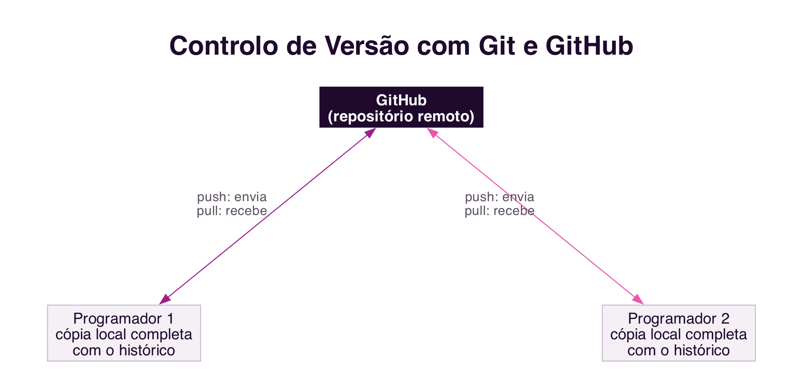
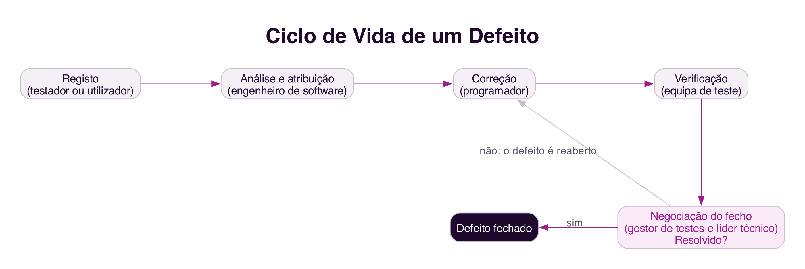

```{=html}
<div class="hero hero-chapter" style="background-image: linear-gradient(to top, rgba(31,10,46,0.88) 0%, rgba(31,10,46,0.6) 20%, rgba(31,10,46,0.15) 45%, rgba(31,10,46,0) 65%), url('../assets/images/heroes/cap08.jpg');">
  <div class="hero-badge">Capítulo 8</div>
  <h1>Desenvolvimento Colaborativo de Software</h1>
</div>
```

## Introdução {#sec-08-intro .unnumbered}

Os capítulos anteriores discutiram a colaboração em espaços virtuais e
na relação entre cidadãos e governo. Este capítulo volta-se para um
domínio mais próximo de quem estuda Computação: o desenvolvimento de
software é, ele próprio, uma atividade profundamente colaborativa,
raramente realizada por uma só pessoa, e cada vez mais realizada por
equipas geograficamente distribuídas.

## Desenvolvimento de Software como Atividade Colaborativa {#sec-08-atividade-colaborativa}

O sucesso de uma organização depende cada vez mais do software que usa
como diferencial competitivo, e o desenvolvimento desse software é
raramente uma atividade individual: diversos especialistas precisam de
trabalhar em conjunto, coordenar as suas atividades, tomar decisões e
comunicar continuamente para desenvolver software de qualidade dentro do
prazo e do custo estimados [@SouzaEtAl2011].

A colaboração organiza-se em torno de **modelos**, abstrações do
software que está a ser construído: especificações de requisitos,
modelos de dados e o próprio código-fonte. Os modelos
não são independentes uns dos outros: uma alteração no modelo de dados
(as tabelas da base de dados), por exemplo, exige normalmente alterações
correspondentes no código-fonte (o HTML e o JavaScript que a usam), para
que os dois permaneçam consistentes entre si. Esta dependência torna a coordenação entre
programadores particularmente importante, pois alterações desalinhadas
entre modelos tendem a gerar erros [@SouzaEtAl2011].

### Exemplo: acrescentar um campo {#sec-08-exemplo-modelo}

Suponha-se que a equipa decide que cada aluno passa a ter um endereço de
e-mail. O requisito passa a dizer que o sistema deve guardar o e-mail de
cada aluno; o modelo de dados passa a ter uma coluna `email` na tabela
`aluno`; e o formulário HTML ganha o campo correspondente:

```html
<form>
  <input name="nome">
  <input name="numero">
  <input name="email">   <!-- novo -->
</form>
```

Se a tabela for atualizada e o formulário não, o e-mail nunca é pedido;
se o formulário for atualizado e a tabela não, o e-mail chega, mas não
há onde o guardar e surge um erro. Quem altera um modelo tem de se
coordenar com quem mantém os outros.

### Processo de *software* e papéis {#sec-08-processo}

Uma forma de organizar a colaboração é o próprio **processo de
*software***: o conjunto de métodos, práticas e transformações que um
grupo de pessoas utiliza para desenvolver e manter *software* e os
respetivos produtos. O processo define a sequência em que os métodos são
aplicados, os produtos a entregar (planos de projeto, documentos de
projeto, código, casos de teste), os controlos que ajudam a assegurar a
qualidade e os marcos que permitem avaliar o progresso
[@SouzaEtAl2011].

O processo define também **papéis**, como programadores, analistas de
requisitos, arquitetos de *software* ou gestores. Um papel descreve como
uma pessoa se relaciona com os modelos e com os colegas, e a cada papel
é atribuído um conjunto de operações: a equipa de qualidade identifica
defeitos no código, e os programadores corrigem-nos [@SouzaEtAl2011].

Esta organização liga-se ao que se viu sobre a coordenação: a divisão de
trabalho do Modelo de Atividade (@sec-04-atividade) corresponde à
coordenação do Modelo 3C (@sec-04-3c) e, na ontologia de colaboração, é
o plano de trabalho que define os papéis, as tarefas e os prazos
(@sec-04-ontologia-coordenacao). Numa equipa de desenvolvimento, o
processo de *software* cumpre esse papel, e a atribuição de papéis
permite a cada pessoa perceber como o seu trabalho afeta o dos colegas
[@SouzaEtAl2011].

## Programação em Pares {#sec-08-pares}

A **programação em pares** (*pair programming*) é uma prática proposta
pelo método ágil *Extreme Programming*, em que dois programadores
trabalham juntos num único computador: um escreve o código (o *driver*)
enquanto o outro (o *navigator*) o revê em tempo real, questiona decisões
de implementação e procura casos de teste que possam falhar
[@SouzaEtAl2011]. Em geral, a dupla junta uma pessoa menos experiente a
outra mais experiente.

Não se trata de uma pessoa a programar enquanto outra apenas assiste,
mas de um diálogo constante entre duas pessoas que procuram, em
conjunto, uma solução melhor do que a que cada uma alcançaria sozinha. O
código é revisto por duas pessoas em tempo real, o que reduz a
possibilidade de defeitos e acelera a partilha de conhecimento entre um
programador mais experiente e outro menos experiente. Como qualquer
prática colaborativa, exige uma mudança cultural: abrir o código a outra
pessoa, mesmo o que ainda está a meio, e decidir em conjunto.
Espera-se que a produtividade aumente com a prática, à medida que a dupla aprende a
comunicar e a dividir melhor o trabalho entre si, e convém planear os
pares para evitar conflitos desnecessários [@SouzaEtAl2011].

## Sistemas de Controlo de Versão {#sec-08-versao}

O **controlo de versão** é a disciplina responsável por controlar a
evolução e a integridade de um produto de software ao longo do tempo,
identificando, registando e coordenando as alterações feitas por
diferentes membros da equipa [@SouzaEtAl2011]. Hoje, o gestor de versões
de referência é o `Git`, com os repositórios alojados no `GitHub`: cada
programador tem no seu computador uma cópia completa do projeto, com
todo o histórico [@ChaconStraub2014]. O trabalho faz-se em ciclo: o
programador regista as alterações na sua cópia (*commit*), envia-as para
o `GitHub` (*push*) e recebe as dos colegas (*pull*) (@fig-08-versao).

{#fig-08-versao}

Um sistema de controlo de versão apoia a colaboração de várias formas: gera
um registo de alterações que serve de memória partilhada sobre a
evolução do produto; fornece informação de perceção (@sec-04-3c) sobre o
que os colegas estão a fazer, notificando alterações; e possibilita a
coordenação de dependências entre atividades, seja por meio de um
desenvolvimento sequencial, seja em paralelo, com integração posterior
do trabalho de cada pessoa. O `GitHub` integra o controlo de versão com
a gestão de defeitos (*issues*) e a revisão de código (*pull requests*)
no mesmo sistema [@GitHubDocs].

### Conflitos de integração {#sec-08-conflitos}

No desenvolvimento em paralelo, cada pessoa trabalha na sua cópia, muitas
vezes num ramo (*branch*), e o trabalho é depois juntado (*merge*). Se
duas pessoas alteram a mesma linha do mesmo ficheiro, o `Git` não sabe
qual das versões escolher: há um **conflito**. Considere-se um exemplo:
a linha `titulo = "Trabalho de Grupo"` é alterada pela Ana para
`"Trabalho Final"` e, ao mesmo tempo, pelo Rui para `"Projeto de Grupo"`.

1. A Ana envia a sua alteração (*push*).
2. O Rui tenta enviar a dele e é recusado, porque o repositório já tem
   alterações que ele ainda não tem.
3. O Rui recebe-as (*pull*) e o `Git` marca o conflito no ficheiro do
   Rui:

```
<<<<<<< HEAD
titulo = "Projeto de Grupo"
=======
titulo = "Trabalho Final"
>>>>>>> 3f2a1b9
```

Acima de `=======` está a versão do Rui; abaixo, a da Ana. Os dois
decidem então a versão final: o Rui edita o ficheiro, apaga os
marcadores, regista (*commit*) e envia (*push*). Resolver um conflito é
uma decisão da equipa, e não do sistema. Os conflitos são normais, e
dividir o trabalho de modo a que pessoas diferentes mexam em zonas
diferentes do código reduz o problema.

## Sistemas de Gestão de Defeitos {#sec-08-defeitos}

Um software raramente está livre de defeitos, encontrados pela equipa de
qualidade ou pelos próprios utilizadores. Os **sistemas de gestão de
defeitos**, como o `Bugzilla`, o `JIRA` ou os *issues* do `GitHub`,
apoiam o registo, a atribuição e o acompanhamento da resolução de
defeitos, envolvendo tipicamente vários atores em papéis distintos:
quem testa, quem desenvolve, e quem gere a equipa (@fig-08-defeitos)
[@SouzaEtAl2011].

{#fig-08-defeitos}

Um defeito é registado por quem o encontra, o testador ou um
utilizador, e analisado por um engenheiro de *software*, que o encaminha
para um programador. O programador corrige o defeito e descreve a
solução no sistema, para que a equipa de teste verifique se o defeito foi
de facto removido e se a alteração não causou outros defeitos; a equipa
de teste pode rejeitar a correção. O gestor de testes e o líder técnico
negociam o fecho: se o defeito estiver resolvido, é fechado; se não, é
reaberto e o ciclo recomeça. Além do registo e da solução,
estes sistemas possibilitam priorizar defeitos, gerar relatórios sobre o
estado de cada um, e identificar defeitos semelhantes ou já reportados,
o que é particularmente útil para equipas geograficamente distribuídas,
cujos membros nem sempre têm oportunidade de se encontrar pessoalmente
para discutir uma solução [@SouzaEtAl2011].

## Desenvolvimento Distribuído e Global {#sec-08-distribuido}

A globalização dos negócios refletiu-se também no desenvolvimento de
software: é cada vez mais comum que os membros de uma mesma equipa
estejam separados por distância física e temporal, e que um projeto
envolva participantes de diferentes países, culturas e fusos horários.
Quando os participantes estão em mais de um país, fala-se de
desenvolvimento **global** [@SouzaEtAl2011].

A distância entre colaboradores afeta a colaboração. Um estudo clássico
de Thomas Allen, em 1977, mostrou que a frequência de colaboração entre
programadores e engenheiros era inversamente proporcional à distância física entre as
suas salas: a partir de cerca de 30 metros, a colaboração entre colegas
ficava prejudicada [@Allen1977; @SouzaEtAl2011]. O efeito é explicado
pela perda de oportunidades de **comunicação informal**, as conversas
espontâneas de corredor ou de máquina de café, sem qualquer agendamento
prévio, através das quais os colegas tomam conhecimento do andamento do
trabalho uns dos outros e encontram soluções conjuntas para problemas
comuns. A comunicação formal, pelo contrário, é a que está combinada à
partida, como uma reunião agendada.

Os sistemas de comunicação estudados no @sec-05-cmc, como as mensagens
instantâneas e a videoconferência, ajudam a reduzir a distância entre
pessoas, mas a distância física entre profissionais que precisam de
colaborar continua a ser um desafio, a par de outros fatores: os fusos
horários, as diferenças de língua (que podem gerar ambiguidades e
mal-entendidos) e as normas culturais (que afetam a forma como as
equipas comunicam e tomam decisões) [@SouzaEtAl2011].

Os estudos sobre o efeito da distância no desenvolvimento de *software*
disponíveis em 2011 eram inconclusivos. Alguns sugeriam que as
distâncias física, temporal e cultural afetam significativamente a
coordenação e chegam a atrasar o desenvolvimento; outros, que o efeito é
cada vez menor, porque as empresas estão a aprender a enfrentar as
barreiras da distância. O efeito dependia de vários fatores, como o
contexto dos projetos, o historial das organizações envolvidas e a
experiência e maturidade dos profissionais [@SouzaEtAl2011].

Estudos mais recentes, centrados em programadores, dão um retrato mais
nítido. Uma revisão sistemática de 46 estudos, publicados entre 2001 e
2013, conclui que a dispersão geográfica tende a prejudicar o desempenho
das equipas e a qualidade do *software*; a dispersão temporal, isto é,
os fusos horários, tende a prejudicar a qualidade, mas o seu efeito no
desempenho é inconsistente [@NguyenDucEtAl2015].

Numa experiência aleatória de seis meses, realizada numa empresa chinesa
de tecnologia, a Trip.com, com 1 612 trabalhadores de engenharia,
marketing e finanças (653 deles programadores), trabalhar de casa dois
dias por semana não alterou as avaliações de desempenho nem as promoções
ao longo de dois anos, nem o número de linhas de código escritas pelos
programadores, e reduziu em um terço as demissões [@BloomEtAl2024].

A proximidade física, porém, continua a ter efeitos. Num estudo com 1 055
programadores de uma grande empresa norte-americana de comércio
eletrónico, entre 2019 e 2024, que aproveitou o fecho dos escritórios e o
regresso obrigatório, sentar-se junto da equipa aumentou em 18,3% o
*feedback* recebido sobre o código e melhorou a sua qualidade,
sobretudo para os programadores mais novos e menos experientes. Houve
também um custo: os programadores mais experientes escreveram menos código
quando estavam perto da equipa. Uma caminhada de dez minutos entre dois
edifícios do mesmo campus reduziu o *feedback* tanto como estar a vários
estados de distância [@EmanuelEtAl2023], o que vai no sentido do efeito
de Allen. Cada um destes estudos incide numa só empresa, e o último é um
documento de trabalho, ainda sem revisão por pares.

## Síntese {#sec-08-sintese}

Este capítulo tratou do desenvolvimento de software como atividade
colaborativa:

1. O desenvolvimento de software organiza-se em torno de **modelos**
   interdependentes, cujas alterações exigem coordenação entre a equipa;
   o processo e os papéis que define ajudam a coordenar
   [@SouzaEtAl2011]
2. A **programação em pares** é uma prática colaborativa em que dois
   programadores trabalham em diálogo constante, diminuindo a
   probabilidade de defeitos e partilhando conhecimento
3. Os **sistemas de controlo de versão**, hoje o `Git` com os
   repositórios no `GitHub`, coordenam as alterações de uma equipa,
   mantêm um registo do histórico do produto e assinalam os conflitos de
   integração
4. Os **sistemas de gestão de defeitos** apoiam o ciclo de vida
   colaborativo de um defeito, do registo à verificação da correção
5. O **desenvolvimento distribuído e global** é cada vez mais comum, mas
   a distância física entre colaboradores prejudica a comunicação
   informal, essencial para a colaboração; os estudos mais recentes
   mostram que o trabalho híbrido não prejudicou o desempenho, mas que a
   proximidade ajuda sobretudo os programadores mais novos

## Para Refletir {#sec-08-reflexao}

Se já trabalhaste num projeto de programação em grupo, pensa em como
foi feita a coordenação do código: usaram algum sistema de controlo de
versão? Como resolveram conflitos quando duas pessoas alteravam o mesmo
ficheiro?

E quanto à distância física: já sentiste, num trabalho de grupo, a
diferença entre resolver um problema presencialmente e tentar
resolvê-lo apenas por mensagem?

## Referências {#sec-08-referencias .unnumbered}

::: {#refs}
:::
