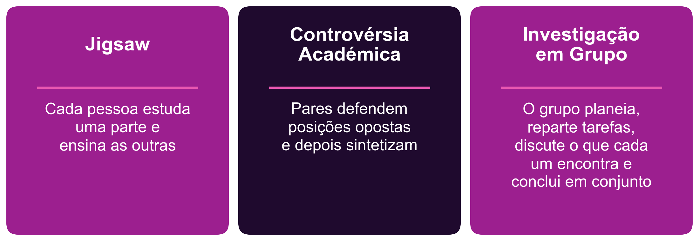
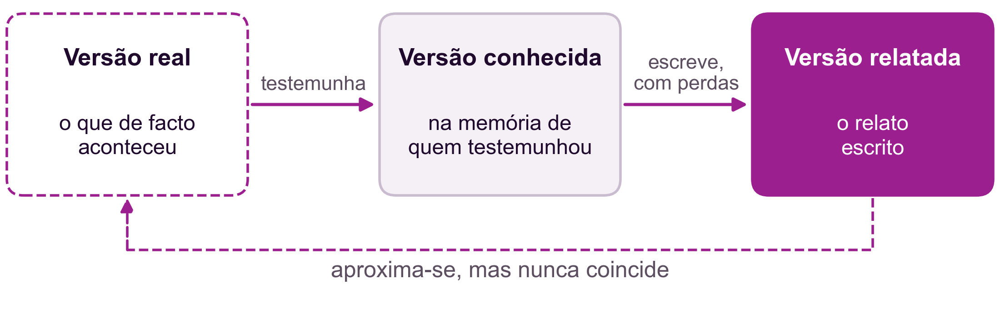
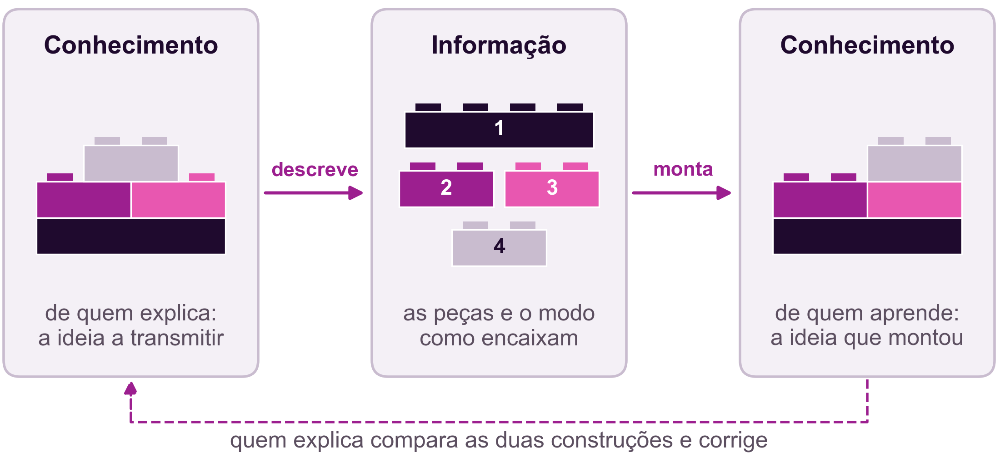

```{=html}
<div class="hero hero-chapter" style="background-image: linear-gradient(to top, rgba(31,10,46,0.88) 0%, rgba(31,10,46,0.6) 20%, rgba(31,10,46,0.15) 45%, rgba(31,10,46,0) 65%), url('../assets/images/heroes/cap09.jpg');">
  <div class="hero-badge">Capítulo 9</div>
  <h1>Aprendizagem Colaborativa e Conhecimento Coletivo</h1>
</div>
```

## Introdução {#sec-09-intro .unnumbered}

As primeiras tentativas de usar o computador no ensino viam-no como um
professor automatizado: um sistema que apresentava o conteúdo em pequenas
partes, verificava de imediato as respostas e reforçava os comportamentos
corretos, segundo os princípios behavioristas da instrução programada
[@CastroMenezes2011]. Quem aprendia estudava ao seu ritmo, como recetor
passivo de informação. Antes da Internet, o computador ensinava, mas
ensinava sozinho.

A ideia de aprender com os outros é anterior a essas tentativas. O estudo
de métodos dedicados à aprendizagem colaborativa começou no início do
século XX, com John Dewey, e foi retomado com maior intensidade a partir da
década de 1970, destacando-se o trabalho de Robert Slavin e de outros
investigadores da Johns Hopkins University [@CastroMenezes2011]. Neste
paradigma, o conhecimento não passa pronto de uma pessoa para outra: cada
uma constrói-o. Com os sistemas de comunicação e as redes sociais, o
computador deixa de ser o professor e passa a ser a plataforma através da
qual as pessoas colaboram.

## Aprendizagem Colaborativa {#sec-09-aprendizagem-colaborativa}

Aprender é uma atividade que decorre da procura contínua de adaptação ao
meio físico e social e que acontece em todos os momentos da vida
[@CastroMenezes2011]: perante um *software* novo, um cargo novo ou uma
formação na empresa, tanto como numa sala de aula. Muito se aprende com os
outros: resolvendo problemas em conjunto, obtendo explicações sobre
problemas já resolvidos, explicando soluções próprias, debatendo vantagens e
desvantagens de uma escolha, fazendo e recebendo críticas e construindo
sínteses coletivas [@CastroMenezes2011].

A **aprendizagem colaborativa** junta pessoas que querem ou precisam de
aprender, numa escola, numa empresa ou noutro contexto, e assenta em dois
princípios [@CastroMenezes2011]:

1. as pessoas trabalham juntas para aprender;
2. cada uma é responsável pela sua própria aprendizagem e pela das outras.

Estes princípios implicam objetivos coletivos: quanto melhor forem
cumpridos, maiores são as possibilidades de aprendizagem de cada
participante [@CastroMenezes2011]. É esta interdependência que distingue a
aprendizagem colaborativa de um simples trabalho de grupo.

## Métodos de Aprendizagem Colaborativa {#sec-09-metodos}

Três métodos ilustram formas concretas de estruturar a aprendizagem
colaborativa (@fig-09-metodos): o *Jigsaw*, a Controvérsia Académica e a
Investigação em Grupo. Têm um historial consistente de uso em contexto
escolar, são claramente distintos entre si e há relatos da sua aplicação com
suporte computacional [@CastroMenezes2011]. Nada impede que sejam usados
noutras situações em que haja quem queira ou precise de aprender. Nas
descrições seguintes, **quem orienta** é a pessoa que prepara e acompanha a
atividade: um professor, numa escola, ou quem assuma essa função noutro
contexto.

{#fig-09-metodos fig-pos="H"}

### *Jigsaw* {#sec-09-jigsaw}

O ***Jigsaw*** ("quebra-cabeças" ou *puzzle*) foi desenvolvido por Elliot
Aronson num projeto educativo no Texas, para criar um ambiente de estudo em
que todos são valorizados, aumentar a colaboração e a partilha e eliminar a
competição excessiva. O tema é dividido em partes e cada pessoa explora uma
delas, trazendo ao grupo a sua "peça" [@CastroMenezes2011]. A abordagem
original tem quatro estágios:

1. **Introdução**: quem orienta organiza os grupos *Jigsaw* (os grupos
   originais) e apresenta os tópicos e os materiais de apoio.
2. **Exploração**: os participantes reorganizam-se em grupos de
   especialistas e estudam cada tópico em profundidade.
3. **Relato e transformação**: cada um regressa ao grupo original e explica
   aos outros o tópico que estudou, partindo da premissa de que, para
   compreender o todo, é preciso compreender primeiro as partes.
4. **Integração e avaliação**: o que foi obtido nos grupos originais é
   integrado com todos e o resultado é avaliado.

A interdependência é total: cada pessoa tem uma peça que as outras não têm
e, sem a contribuição de todas, o grupo não reconstrói o tema completo. Quem
orienta tem um papel central, porque pedir às pessoas que trabalhem em grupo
não basta: os grupos sem estrutura nem incentivo não alcançam efeitos
positivos na aprendizagem. Na variante *Jigsaw II*, proposta por Slavin,
todos podem ler todo o conteúdo e complementar a explicação de cada colega,
o que simplifica a preparação [@CastroMenezes2011].

Um exemplo fora da escola: uma empresa adota um *software* novo. Cada pessoa
junta-se às que ficaram com o mesmo módulo, estuda-o com elas e regressa à
sua equipa para o ensinar.

### Controvérsia Académica {#sec-09-controversia}

A **Controvérsia Académica** procura chegar a um consenso quando há
discordância sobre uma ideia, informação, conclusão, teoria ou opinião. Os
conflitos intelectuais são inevitáveis e desejáveis, porque promovem um
raciocínio mais elaborado, maior retenção e maior criatividade do que a
aprendizagem competitiva e individualista. Para trazer benefícios, o método
exige um contexto colaborativo, participantes heterogéneos, informação
relevante distribuída entre eles e capacidade de argumentação racional
[@CastroMenezes2011].

As duas posições têm de estar em confronto: posições apenas diferentes e
complementares juntam-se sem discussão, situação própria do *Jigsaw*. Um
critério prático permite confirmá-lo: aceitar uma posição obriga a contestar
a outra, ambas se podem defender com argumentos e é possível construir uma
síntese. A posição de cada par é designada e pode não corresponder à opinião
de quem a defende, o que torna possível a inversão.

O método estrutura-se em cinco atividades [@CastroMenezes2011]:

1. **Preparação**: num grupo de quatro pessoas, dividido em dois pares, cada
   par recebe uma das duas posições, pesquisa-a e constrói os argumentos.
2. **Apresentação**: cada par apresenta o melhor argumento possível e ouve
   com atenção o do outro par.
3. **Discussão aberta**: os pares continuam a defender a sua posição,
   analisam criticamente a contrária e respondem às críticas.
4. **Inversão**: os pares trocam de posição e defendem a posição oposta, de
   forma completa e persuasiva.
5. **Síntese**: o grupo de quatro volta a reunir-se e integra as melhores
   ideias de ambos os lados numa única posição.

O objetivo não é vencer o debate: é chegar à melhor posição sobre o assunto
e a argumentos com que todo o grupo possa concordar e comprometer-se. Numa
empresa que pondera mudar de *software*, por exemplo, um par defende "mudar
já" e o outro "esperar um ano"; uma síntese possível é mudar já, mas só numa
equipa.

### Investigação em Grupo {#sec-09-investigacao}

Na **Investigação em Grupo**, os participantes trabalham em pequenos grupos
para examinar, experimentar e compreender os temas centrais de estudo. O
método combina em simultâneo quatro componentes [@CastroMenezes2011]:

- **investigação**: a aprendizagem é organizada como um processo de
  investigação;
- **interação**: a dimensão social, a comunicação entre os membros do grupo;
- **interpretação**: o esforço individual de dar significado à informação
  recolhida;
- **motivação intrínseca**: o envolvimento emocional de cada um no que
  estuda.

Desenvolve-se em seis estágios [@CastroMenezes2011]:

1. identificar o tema e organizar os grupos, por interesses e de forma
   heterogénea;
2. planear em conjunto o que estudar e como, dividir as tarefas e definir os
   objetivos;
3. executar a investigação: recolher informação, analisar dados e tirar
   conclusões;
4. preparar o relatório final;
5. apresentar o relatório final;
6. avaliar o trabalho de cada grupo.

O grupo planeia e conclui em conjunto; cada elemento cumpre as suas tarefas
e faz a sua própria interpretação. Ninguém aprende isolado.

### *Jigsaw* ou Investigação em Grupo? {#sec-09-comparacao}

Os dois métodos dividem trabalho, mas não dividem a mesma coisa
(@tbl-09-comparacao).

| | *Jigsaw* | Investigação em Grupo |
|:---|:---|:---|
| **O que se divide** | o conteúdo a aprender, em partes | as tarefas de uma investigação comum |
| **Quem divide** | quem orienta a atividade | o próprio grupo, ao planear |
| **Como se partilha** | numa etapa obrigatória, em que cada um ensina a sua parte | por interação ao longo do trabalho, sem etapa de ensino |
| **O que se pretende** | que cada um compreenda o todo | que o grupo investigue um tema e o apresente num relatório |

: Comparação entre o *Jigsaw* e a Investigação em Grupo, a partir das descrições de @CastroMenezes2011. {#tbl-09-comparacao tbl-colwidths="[22,38,40]"}

Em ambos há divisão. Só o *Jigsaw* obriga cada pessoa a ensinar a sua parte:
a Investigação em Grupo prevê interação e interpretação individual, mas a
descrição do método não inclui uma etapa em que cada um ensine os outros.

### Dividir o trabalho não é colaborar {#sec-09-dividir}

No modelo da Teoria da Atividade (@sec-04-atividade), a divisão de trabalho
organiza quem faz o quê. No Modelo 3C (@sec-04-3c), corresponde à
**coordenação**, uma das três dimensões da colaboração, a par da
**comunicação** e da **cooperação** [@FuksEtAl2011]. Repartir tarefas é
necessário, mas não chega.

Um caso frequente é o de um *site* feito em grupo: uma pessoa faz só o HTML,
outra só o CSS e outra só o JavaScript; no fim juntam os ficheiros e cada uma
conhece apenas a sua parte. É um *Jigsaw* por acabar: faltam o grupo de
especialistas, o ensino aos colegas (estágio 3) e a integração e avaliação
(estágio 4). Falha também o princípio de que cada pessoa é responsável pela
aprendizagem das outras.

Para realizar um trabalho, a perceção do Modelo 3C não exige que cada um
saiba tudo o que os outros fazem: basta saber o suficiente para fazer a sua
parte em articulação com as restantes. Quando o objetivo é aprender, é
diferente, porque cada pessoa precisa de compreender o todo. **Se todos têm
de saber tudo, cada um tem de ensinar a sua parte**: convém marcar um momento
para isso e confirmar que todos conseguem explicar as três.

### Componentes essenciais {#sec-09-componentes}

Apesar de diferentes entre si, os três métodos partilham componentes
essenciais [@CastroMenezes2011]: **objetivos de grupo**, que incentivam os
participantes a apoiarem-se uns aos outros; **responsabilidade individual**,
que exige que cada membro domine os conceitos que explica aos colegas; e
**oportunidade igual de sucesso**, que reconhece cada pessoa pelo seu
esforço, independentemente das suas capacidades de partida.

## Suporte Computacional {#sec-09-suporte}

A colaboração requer sistemas para registar as produções individuais,
partilhá-las, coordenar as ações, recuperar a informação produzida e refletir
sobre o resultado. Além dos sistemas de comunicação (correio eletrónico,
listas de discussão, *chat* e fórum), os métodos pedem apoio para formar
grupos (por interesses, conhecimento prévio ou perfil), preparar a
atividade, explorar tópicos, argumentar, registar e refletir (*blog*,
*wiki*), sintetizar (glossários e mapas concetuais), organizar conteúdos e
planear, acompanhar e avaliar o trabalho [@CastroMenezes2011].

### Os três C na aprendizagem colaborativa {#sec-09-3c}

Cruzando estes apoios com o Modelo 3C (@sec-04-3c), obtém-se a organização da
@tbl-09-3c. Os três C não funcionam isolados: da comunicação nascem
compromissos, a coordenação organiza-os e a cooperação traz imprevistos que
pedem nova comunicação [@FuksEtAl2011].

| Dimensão | O que se faz | Com que apoio |
|:---|:---|:---|
| **Comunicação** | explicar, argumentar e esclarecer dúvidas | fórum, *chat* e videoconferência (@sec-05-sincronismo) |
| **Coordenação** | formar grupos, planear, repartir papéis e tarefas, avaliar | gestão de grupos, calendário, avaliação por pares |
| **Cooperação** | registar, refletir, sintetizar e construir em conjunto | *blog*, *wiki*, glossário, mapa concetual |

: As três dimensões do Modelo 3C na aprendizagem colaborativa. {#tbl-09-3c tbl-colwidths="[20,42,38]"}

No *Jigsaw*, por exemplo, há comunicação quando cada um explica a sua parte
aos outros; coordenação quando se formam os grupos originais e de
especialistas e se decide quem fica com cada parte; e cooperação quando o
grupo junta as partes numa síntese comum. A **perceção**, ao centro do
modelo, é ter noção do que os outros estão a fazer. Numa atividade de
aprendizagem interessa também saber o que cada um já compreendeu, para que
seja possível comparar e corrigir.

### O que cada método exige da plataforma {#sec-09-exigencias}

Na transposição dos métodos para contextos mediados por computador usam-se
guiões de colaboração (*CSCL scripts*), assentes em três esquemas principais
[Kobbe et al., 2007, citados por @CastroMenezes2011]. Cada um coloca
exigências diferentes à plataforma (@tbl-09-esquemas).

| Método e esquema | Como se organiza a interação | O que se pede à plataforma |
|:---|:---|:---|
| ***Jigsaw*** (esquema *Jigsaw*) | pares ou grupos com informação complementar | conteúdos organizados pela partição do tema |
| **Controvérsia Académica** (esquema do conflito) | pares com opiniões contraditórias, para criar conflito sociocognitivo | conteúdos agrupados a favor e contra, e um fórum onde os papéis possam alternar |
| **Investigação em Grupo** (esquema recíproco) | papéis alternados de questionamento e de tutoria | pesquisa de recursos na web, por exemplo com marcação colaborativa (@sec-03-folksonomia) |

: Esquemas de colaboração e exigências colocadas à plataforma, a partir de @CastroMenezes2011. {#tbl-09-esquemas tbl-colwidths="[28,34,38]"}

Os ambientes virtuais de apoio ao ensino e à aprendizagem replicam, na sua
grande maioria, estruturas rígidas de organização das atividades, muito
limitantes para a variedade de esquemas destes métodos [@CastroMenezes2011].
A plataforma deve servir o método, e não o contrário.

### Plataformas atuais {#sec-09-plataformas}

A @tbl-09-plataformas sugere formas de montar cada método em plataformas
atuais; a escolha depende do que cada grupo ou organização já usa. O Moodle
permite criar grupos e agrupamentos, dar a cada grupo o seu fórum e usar as
atividades *wiki*, glossário e *workshop*, esta última de avaliação por
pares, com atribuição manual ou aleatória dos avaliadores
[@MoodleDocs2026]. No Microsoft Teams, as salas de grupo de uma reunião podem
ser atribuídas manualmente ou ao acaso [@TeamsSalas2026]. O Miro é um quadro
colaborativo para trabalho em tempo real ou assíncrono, com comentários
[@Miro2026].

| Método | O que é preciso | Moodle | Outra ferramenta |
|:---|:---|:---|:---|
| ***Jigsaw*** | grupos originais e de especialistas; conteúdos por parte | grupos e agrupamentos, com um fórum por grupo | Teams: salas de grupo para cada ronda |
| **Controvérsia Académica** | pares com posições opostas, discussão aberta e inversão | um fórum por par e um fórum comum | Teams: uma sala por par e a sala principal para a discussão |
| **Investigação em Grupo** | planear, registar, sintetizar e avaliar | *wiki* para o relatório e *workshop* para a avaliação | Miro: planeamento e mapas concetuais |

: Sugestões de uso de plataformas atuais para cada método. {#tbl-09-plataformas tbl-colwidths="[20,28,26,26]"}

## Conhecimento Coletivo {#sec-09-conhecimento-coletivo}

Muitos dos problemas que hoje se resolvem em organizações são demasiado
complexos e multidisciplinares para uma só pessoa. O **conhecimento
coletivo** é a combinação dos conhecimentos individuais de um grupo com um
objetivo comum, e é mais rico do que a simples soma desses conhecimentos,
porque a combinação de diferentes perspetivas revela relações que não são
visíveis quando cada conhecimento é apresentado de forma isolada
[@Borges2011].

Quando um episódio passado não foi documentado, é preciso recuperá-lo a
partir dos testemunhos de quem o presenciou. Contar histórias é uma forma de
representar esse conhecimento, mas em situações complexas dificilmente uma
pessoa sozinha consegue contar a história inteira, porque cada uma conhece
apenas uma parte [@Borges2011].

### Um episódio, vários relatos {#sec-09-episodio}

@Borges2011 propõe um episódio hipotético: uma perseguição numa rua, relatada
por nove testemunhas. A @tbl-09-relatos apresenta oito desses relatos,
adaptados; o nono é o de Adriana, dona de uma loja onde ocorre um assalto.

| Testemunha | Relato |
|:---|:---|
| **Mariano**, a caminhar na rua | "Vi três homens a correr, dois mais atrás e um à frente. Parecia uma perseguição. Pouco depois ouvi uma sirene e uns estalidos que pareciam tiros." |
| **Flávia**, a sair de uma loja | "Um homem que corria esbarrou em mim e derrubou-me. Vi uma carteira ao meu lado e gritei 'a carteira!', mas ele continuou a correr." |
| **Hugo**, polícia em ronda | "Vi uma mulher caída no chão a gritar 'a carteira!' e três homens a afastar-se a correr. Pensei que fosse um assalto e fui atrás deles." |
| **José**, motorista de autocarro | "Dois homens pediram para entrar e para esperar por um terceiro. Quando este entrou, fechei a porta e arranquei." |
| **Marcelo**, à espera do autocarro | "Passaram por mim três homens a correr e um quarto, que disparou três vezes para o ar. Mais à frente, vi um polícia de arma na mão atrás de uma parede." |
| **Rafael**, a caminho do metro | "Vi dois homens a correr na minha direção. Na estação, uma mulher, muito nervosa, dizia que a polícia perseguia traficantes." |
| **Renata**, amiga de Flávia | "Encontrei a Flávia caída no chão. Mostrou-me uma carteira e, pela fotografia, reconheci o dono: o Amauri, meu vizinho." |
| **Vanessa**, à janela do 7.º andar | "Vi pessoas a correr em todas as direções e um polícia de arma na mão. Pensei que fossem carteiristas, fechei a janela e voltei ao trabalho." |

: Oito relatos do mesmo episódio, adaptados de @Borges2011. {#tbl-09-relatos tbl-colwidths="[24,76]"}

Cada narrador seleciona o que inclui no relato e interpreta o que viu a
partir da sua perspetiva. Nos relatos misturam-se factos (Marcelo vê um homem
disparar), interpretações (Mariano ouve sons que lhe parecem tiros) e
especulações (Vanessa supõe que se trata de carteiristas). Como quem relata
nem sempre distingue estes casos, cabe a quem recebe identificá-los e, se
necessário, perguntar [@Borges2011].

### As três versões de um episódio {#sec-09-versoes}

Na recuperação de um episódio distinguem-se três versões (@fig-09-versoes)
[@Borges2011]:

- a **versão real**, o que de facto aconteceu, um conceito abstrato que
  raramente é possível reconstituir por completo;
- a **versão conhecida**, guardada na mente de quem testemunhou o episódio;
- a **versão relatada**, o relato escrito a partir da lembrança dos
  narradores.

A versão conhecida é **conhecimento tácito**: está na mente de quem o detém e
ainda não foi formalizado. É concreto para essa pessoa, que nem sempre sabe
tudo o que sabe, mas abstrato para as outras enquanto não for transmitido.
Opõe-se ao **conhecimento formal** (explícito), que fica registado e pode ser
consultado por quem não esteve presente. O que Hugo viu na rua é tácito; se o
contar a um colega, continua tácito, agora em duas pessoas; quando escrever o
relatório, passa a formal.

{#fig-09-versoes fig-pos="H"}

### Transmitir conhecimento: a informação e a reconstrução {#sec-09-transmissao}

O conhecimento pode transmitir-se através da informação, quando esta é
guiada por quem explica, de modo que a outra pessoa forme a ideia que se
pretende transmitir. Pode pensar-se no conhecimento como um objeto construído
em LEGO (@fig-09-lego): com as mesmas peças montam-se construções muito
diferentes. A **informação** são as peças e o modo como encaixam umas nas
outras. Transmitir é conseguir descrever a construção de modo que a outra
pessoa monte, do seu lado, a mesma, ou seja, tenha a mesma ideia.

{#fig-09-lego fig-pos="H"}

Quem explica precisa, por isso, de ver o que foi montado, comparar e
corrigir: na figura, a peça de cima ficou fora do sítio. Contam também as
peças que quem aprende já tem: se faltam peças, isto é, conhecimento prévio,
a melhor descrição não chega. O que viaja é a informação; o conhecimento é
remontado por quem a recebe.

### As perdas na transmissão {#sec-09-perdas}

@Borges2011 chama transmissão do conhecimento a dois processos:

- a **socialização**, a explicação oral, que replica o conhecimento noutras
  mentes, mas o mantém no nível tácito e só chega a quem está presente: o
  resultado é outra versão conhecida, em quem ouviu;
- a **externalização**, ou formalização, o registo escrito, que traz o
  conhecimento do nível tácito ao formal e permite partilhá-lo com mais
  pessoas e expandi-lo: o resultado é a versão relatada.

Em ambos há perdas. Na socialização, quem conta um conto acrescenta um ponto:
a cada nova transmissão, parte do conhecimento perde-se e o que passa
altera-se. É o efeito que @Borges2011 designa por "telefone sem fio", o jogo
conhecido em Portugal por "telefone estragado". Na externalização, nem sempre
se consegue escrever tudo o que se tem na memória.

Por isso a versão relatada difere da conhecida: deixa de fora o que cada
narrador não achou relevante, esqueceu ou percebeu mal. No episódio da rua,
nenhum narrador descreve os homens que correm, o que talvez ajudasse a
identificá-los nos outros relatos, e Hugo, o polícia, não refere os tiros que
Mariano ouviu e Marcelo viu. Recuperar o que aconteceu exige combinar várias
versões.

## *Group Storytelling* {#sec-09-storytelling}

O ***group storytelling***, ou contagem de histórias em grupo, é uma técnica
de construção de histórias em que mais de uma pessoa contribui, de forma
síncrona ou assíncrona, no mesmo local ou à distância, por meio de diversos
meios. Há vários narradores, mas uma só história, que por vezes mantém várias
versões, para refletir perspetivas diferentes ou controvérsias não
resolvidas. Aplicado à recuperação do conhecimento, procura aproximar a
versão relatada da versão conhecida por cada participante [@Borges2011].

A técnica atribui, tipicamente, quatro papéis [@Borges2011]:

- **narrador** (o contador da história): uma pessoa envolvida no episódio, ou
  que pode contribuir para a sua construção, que relata a sua versão dos
  factos;
- **facilitador**: procura inconsistências, contradições e lacunas, relaciona
  os relatos, levanta questões e estimula a participação;
- **revisor**: identifica passagens ambíguas, incompletas ou mal redigidas; é
  um papel opcional, porque o facilitador também o pode fazer;
- **administrador**: coordena a dinâmica, convida os participantes, cria a
  estrutura inicial e estabelece prazos.

Cada participante pode ter mais do que um papel e cada papel pode ser
exercido por mais do que uma pessoa. A recuperação depende de uma atitude
colaborativa: se as pessoas não quiserem colaborar, é muito difícil. As
lacunas deixadas por falhas de memória não devem ser preenchidas com
especulação; as conjeturas ficam separadas dos factos, para não induzir
relatos falsos [@Borges2011].

### Relações entre relatos {#sec-09-relacoes}

Os relatos de um mesmo episódio relacionam-se de várias formas. A
@tbl-09-relacoes apresenta quatro, com exemplos do episódio da rua; há
outras, como a posposição, a simultaneidade e a contraposição [@Borges2011].

| Relação | Quando ocorre | No episódio da rua |
|:---|:---|:---|
| **Confirmação** | um relato confirma o que outro já descreveu | Marcelo vê um polícia de arma na mão; Vanessa, da janela, vê o mesmo |
| **Inconsistência** | dois relatos têm informações em conflito | Mariano vê três homens a correr, Rafael vê dois e Marcelo vê quatro |
| **Precedência** | um evento antecede outro no tempo | Flávia cai antes de Renata chegar e a encontrar no chão |
| ***Gap*** | falta informação entre eventos para que se perceba o que aconteceu | falta ligar os relatos da rua ao de José, o motorista do autocarro |

: Relações entre relatos, com exemplos do episódio da @tbl-09-relatos. {#tbl-09-relacoes tbl-colwidths="[20,38,42]"}

Representar estas relações numa rede semântica, mesmo incompleta, ajuda a
organizar os eventos e a ver o que falta. Explicitar um *gap* é também uma
forma de conhecimento: pode levar um narrador a lembrar-se de algo, ou mostrar
que são precisos mais narradores [@Borges2011].

As relações são mais ricas quando são os próprios narradores a estabelecê-las.
Ao lerem os relatos dos outros, mudam de perspetiva, recordam o que tinham
esquecido e ampliam o seu relato. É esta sinergia que torna o conhecimento
coletivo mais do que a soma dos conhecimentos individuais [@Borges2011].

## Síntese {#sec-09-sintese}

Este capítulo tratou da aprendizagem como processo social e da construção
coletiva do conhecimento:

1. A **aprendizagem colaborativa** substitui o computador-professor por uma
   construção conjunta do conhecimento, entre pessoas que se responsabilizam
   umas pelas outras [@CastroMenezes2011]
2. O ***Jigsaw***, a **Controvérsia Académica** e a **Investigação em Grupo**
   estruturam a interdependência de formas diferentes; só o *Jigsaw* obriga
   cada pessoa a ensinar a sua parte [@CastroMenezes2011]
3. **Dividir o trabalho não é colaborar**: a coordenação tem de ser
   acompanhada de comunicação e cooperação [@FuksEtAl2011]
4. O **conhecimento coletivo** é mais rico do que a soma dos conhecimentos
   individuais; a recuperação de um episódio distingue a versão real, a
   conhecida e a relatada [@Borges2011]
5. O que se transmite é informação, que quem a recebe tem de reconstruir; em
   qualquer transmissão há perdas
6. O ***group storytelling*** recupera coletivamente o conhecimento sobre um
   episódio, através de papéis definidos e da explicitação das relações entre
   relatos [@Borges2011]

## Para Refletir {#sec-09-reflexao}

Pensa num trabalho de grupo, na universidade, no emprego ou noutro contexto,
em que usaste um dos três métodos discutidos, mesmo sem lhe saberes o nome:
qual deles, e como correu a interdependência entre os membros do grupo?

E quanto ao *group storytelling*: já reconstituíste, com colegas ou amigos, a
história de um acontecimento partilhado, cada um a partir da sua própria
versão? Que inconsistências ou lacunas encontraste entre os relatos?

## Referências {#sec-09-referencias .unnumbered}

::: {#refs}
:::
