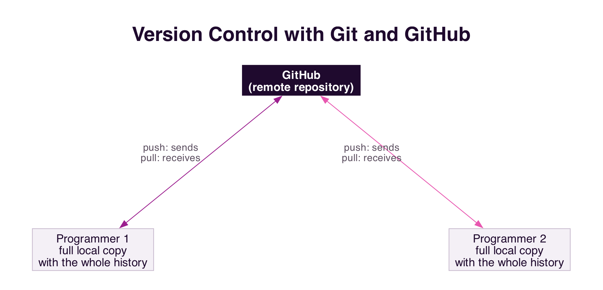
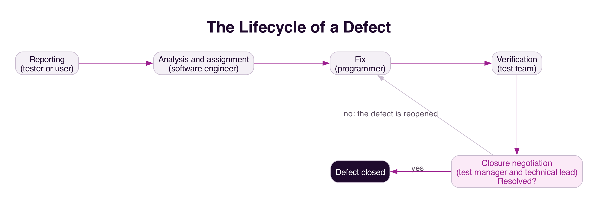

```{=html}
<div class="hero hero-chapter" style="background-image: linear-gradient(to top, rgba(31,10,46,0.88) 0%, rgba(31,10,46,0.6) 20%, rgba(31,10,46,0.15) 45%, rgba(31,10,46,0) 65%), url('../assets/images/heroes/cap08.jpg');">
  <div class="hero-badge">Chapter 8</div>
  <h1>Collaborative Software Development</h1>
</div>
```

## Introduction {#sec-08-intro-en .unnumbered}

The previous chapters discussed collaboration in virtual environments and in the relationship between citizens and government. This chapter turns to a domain closer to those studying Computing: software development is itself a deeply collaborative activity, rarely carried out by a single person, and increasingly carried out by geographically distributed teams.

## Software Development as a Collaborative Activity {#sec-08-collaborative-activity-en}

The success of an organisation increasingly depends on the software it uses as a competitive differentiator, and developing that software is rarely an individual activity: several specialists need to work together, coordinate their activities, make decisions and communicate continuously to develop quality software within the estimated time and cost [@SouzaEtAl2011].

Collaboration is organised around **models**, abstractions of the software being built: requirements specifications, data models and the source code itself. Models are not independent of one another: a change in the data model (the database tables), for example, usually requires corresponding changes in the source code (the HTML and JavaScript that use it), so that the two remain consistent with each other. This dependency makes coordination between programmers particularly important, since misaligned changes between models tend to generate errors [@SouzaEtAl2011].

### Example: Adding a Field {#sec-08-model-example-en}

Suppose the team decides that each student will now have an e-mail address. The requirement now says that the system must store each student's e-mail; the data model gains an `email` column in the `aluno` table; and the HTML form gains the corresponding field:

```html
<form>
  <input name="nome">
  <input name="numero">
  <input name="email">   <!-- new -->
</form>
```

If the table is updated and the form is not, the e-mail is never requested; if the form is updated and the table is not, the e-mail arrives but there is nowhere to store it and an error appears. Whoever changes one model has to coordinate with whoever maintains the others.

### The Software Process and Roles {#sec-08-process-en}

One way to organise collaboration is the **software process** itself: the set of methods, practices and transformations that a group of people uses to develop and maintain software and its products. The process defines the sequence in which methods are applied, the products to be delivered (project plans, design documents, code, test cases), the controls that help ensure quality and the milestones that allow progress to be assessed [@SouzaEtAl2011].

The process also defines **roles**, such as programmers, requirements analysts, software architects or managers. A role describes how a person relates to the models and to colleagues, and each role is assigned a set of operations: the quality team identifies defects in the code, and programmers fix them [@SouzaEtAl2011].

This organisation connects with what was seen about coordination: the division of labour in the Activity Model (@sec-04-activity-theory-en) corresponds to the coordination of the 3C Model (@sec-04-3c-en) and, in the collaboration ontology, it is the work plan that defines roles, tasks and deadlines (@sec-04-ontology-coordination-en). In a development team, the software process plays that part, and assigning roles lets each person understand how their work affects their colleagues' [@SouzaEtAl2011].

## Pair Programming {#sec-08-pair-programming-en}

**Pair programming** is a practice proposed by the agile method *Extreme Programming*, in which two programmers work together on a single computer: one writes the code (the *driver*) while the other (the *navigator*) reviews it in real time, questions implementation decisions and looks for test cases that might fail [@SouzaEtAl2011]. In general, the pair brings together a less experienced person and a more experienced one.

This is not a matter of one person programming while the other merely watches, but a constant dialogue between two people jointly seeking a better solution than either would reach alone. The code is reviewed by two people in real time, which reduces the likelihood of defects and speeds up the sharing of knowledge between a more experienced programmer and a less experienced one. Like any collaborative practice, it requires a cultural shift: opening the code to another person, even what is still half-done, and deciding together. Productivity is expected to increase with practice, as the pair learns to communicate and better divide the work between them, and pairs should be planned carefully to avoid unnecessary conflicts [@SouzaEtAl2011].

## Version Control Systems {#sec-08-version-control-en}

**Version control** is the discipline responsible for controlling the evolution and integrity of a software product over time, identifying, recording and coordinating the changes made by different team members [@SouzaEtAl2011]. Today, the reference version manager is `Git`, with repositories hosted on `GitHub`: each programmer has a complete copy of the project, with its whole history, on their own computer [@ChaconStraub2014]. Work follows a cycle: the programmer records changes in their copy (*commit*), sends them to `GitHub` (*push*) and receives their colleagues' changes (*pull*) (@fig-08-version-control-en).

{#fig-08-version-control-en}

A version control system supports collaboration in several ways: it generates a change log that serves as shared memory of the product's evolution; it provides awareness information (@sec-04-3c-en) about what colleagues are doing, by notifying changes; and it enables the coordination of dependencies between activities, whether through sequential development or in parallel, with the work of each person integrated afterwards. `GitHub` integrates version control with defect management (*issues*) and code review (*pull requests*) in the same system [@GitHubDocs].

### Integration Conflicts {#sec-08-conflicts-en}

In parallel development, each person works on their own copy, often on a branch, and the work is later combined (*merge*). If two people change the same line of the same file, `Git` cannot tell which version to choose: there is a **conflict**. Consider an example: the line `titulo = "Trabalho de Grupo"` is changed by Ana to `"Trabalho Final"` and, at the same time, by Rui to `"Projeto de Grupo"`.

1. Ana sends her change (*push*).
2. Rui tries to send his and is refused, because the repository already has changes that he does not yet have.
3. Rui receives them (*pull*) and `Git` marks the conflict in Rui's file:

```
<<<<<<< HEAD
titulo = "Projeto de Grupo"
=======
titulo = "Trabalho Final"
>>>>>>> 3f2a1b9
```

Above `=======` is Rui's version; below it, Ana's. The two then decide on the final version: Rui edits the file, deletes the markers, records the change (*commit*) and sends it (*push*). Resolving a conflict is a decision for the team, not for the system. Conflicts are normal, and dividing the work so that different people touch different parts of the code reduces the problem.

## Defect Management Systems {#sec-08-defect-management-en}

Software is rarely free of defects, found either by the quality team or by users themselves. **Defect management systems**, such as `Bugzilla`, `JIRA` or `GitHub` *issues*, support the recording, assignment and tracking of defect resolution, typically involving several actors in distinct roles: those who test, those who develop, and those who manage the team (@fig-08-defect-cycle-en) [@SouzaEtAl2011].

{#fig-08-defect-cycle-en}

A defect is reported by whoever finds it, a tester or a user, and analysed by a software engineer, who forwards it to a programmer. The programmer fixes the defect and describes the solution in the system, so that the test team can verify that the defect was really removed and that the change did not cause other defects; the test team may reject the fix. The test manager and the technical lead negotiate the closure: if the defect is resolved, it is closed; if not, it is reopened and the cycle starts again. Beyond reporting and resolution, these systems make it possible to prioritise defects, generate reports on the status of each one, and identify similar or already-reported defects, which is particularly useful for geographically distributed teams, whose members do not always have the opportunity to meet in person to discuss a solution [@SouzaEtAl2011].

## Distributed and Global Development {#sec-08-distributed-en}

The globalisation of business has also been reflected in software development: it is increasingly common for members of the same team to be separated by physical and temporal distance, and for a project to involve participants from different countries, cultures and time zones. When the participants are in more than one country, this is called **global** development [@SouzaEtAl2011].

Distance between collaborators affects collaboration. A classic study by Thomas Allen, in 1977, showed that the frequency of collaboration between programmers and engineers was inversely proportional to the physical distance between their rooms: from about 30 metres onward, collaboration between colleagues was impaired [@Allen1977; @SouzaEtAl2011]. The effect is explained by the loss of opportunities for **informal communication**, the spontaneous corridor or coffee-machine conversations, with no prior scheduling, through which colleagues learn about each other's progress and find joint solutions to common problems. Formal communication, by contrast, is agreed in advance, such as a scheduled meeting.

The communication systems studied in @sec-05-cmc-en, such as instant messaging and video conferencing, help reduce the distance between people, but physical distance between professionals who need to collaborate remains a challenge, alongside other factors: time zones, differences in language (which can cause ambiguity and misunderstandings) and cultural norms (which affect how teams communicate and make decisions) [@SouzaEtAl2011].

The studies on the effect of distance on software development available in 2011 were inconclusive. Some suggested that physical, temporal and cultural distances significantly affect coordination and even delay development; others, that the effect is increasingly small, because companies are learning to deal with the barriers of distance. The effect depended on several factors, such as the context of the projects, the history of the organisations involved and the experience and maturity of the professionals [@SouzaEtAl2011].

More recent studies, focused on programmers, give a clearer picture. A systematic review of 46 studies published between 2001 and 2013 concludes that geographical dispersion tends to harm team performance and software quality; temporal dispersion, that is, time zones, tends to harm quality, but its effect on performance is inconsistent [@NguyenDucEtAl2015].

In a six-month randomised experiment at a Chinese technology company, Trip.com, with 1,612 engineering, marketing and finance employees (653 of them programmers), working from home two days a week changed neither performance reviews nor promotions over two years, nor the number of lines of code written by programmers, and it reduced quitting by one third [@BloomEtAl2024].

Physical proximity, however, still has effects. In a study of 1,055 programmers at a large US e-commerce company, between 2019 and 2024, which took advantage of the office closures and the return-to-office mandates, sitting near the team increased the feedback received on code by 18.3% and improved its quality, especially for younger and less experienced programmers. There was also a cost: more experienced programmers wrote less code when they were near the team. A ten-minute walk between two buildings on the same campus reduced feedback as much as being several states away [@EmanuelEtAl2023], which points in the direction of Allen's effect. Each of these studies covers a single company, and the last is a working paper, not yet peer-reviewed.

## Summary {#sec-08-summary-en}

This chapter dealt with software development as a collaborative activity:

1. Software development is organised around interdependent **models**, whose changes require coordination within the team; the process and the roles it defines help with coordination [@SouzaEtAl2011]
2. **Pair programming** is a collaborative practice in which two programmers work in constant dialogue, lowering the likelihood of defects and sharing knowledge
3. **Version control systems**, today `Git` with repositories on `GitHub`, coordinate a team's changes, maintain a record of the product's history and flag integration conflicts
4. **Defect management systems** support the collaborative lifecycle of a defect, from reporting to verification of the fix
5. **Distributed and global development** is increasingly common, but physical distance between collaborators hinders the informal communication that is essential for collaboration; more recent studies show that hybrid working did not harm performance, but that proximity helps mainly younger programmers

## Food for Thought {#sec-08-reflection-en}

If you have already worked on a group programming project, think about how the code coordination was done: did you use a version control system? How did you resolve conflicts when two people changed the same file?

And what about physical distance: have you ever felt, in a group project, the difference between solving a problem in person and trying to solve it only by message?

## References {#sec-08-references-en .unnumbered}

::: {#refs}
:::
