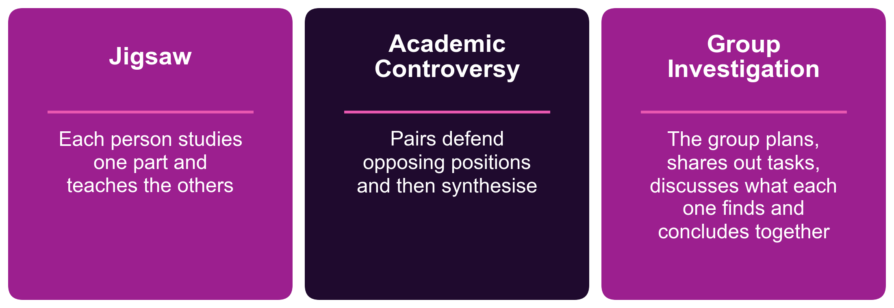
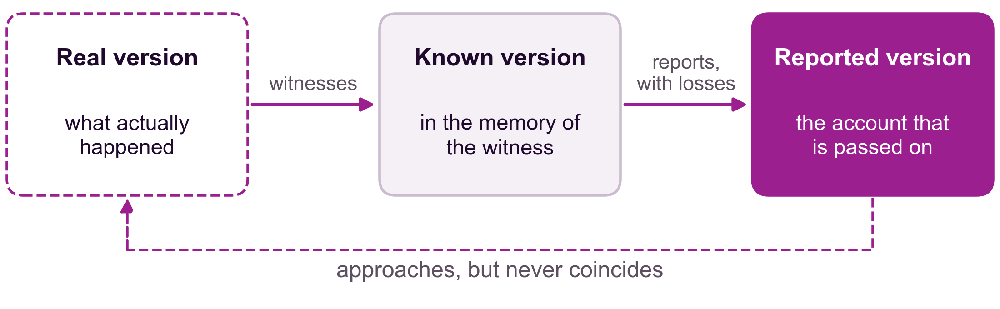
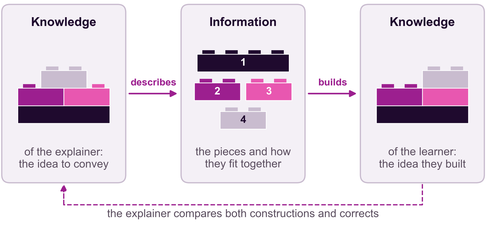

```{=html}
<div class="hero hero-chapter" style="background-image: linear-gradient(to top, rgba(31,10,46,0.88) 0%, rgba(31,10,46,0.6) 20%, rgba(31,10,46,0.15) 45%, rgba(31,10,46,0) 65%), url('../assets/images/heroes/cap09.jpg');">
  <div class="hero-badge">Chapter 9</div>
  <h1>Collaborative Learning and Collective Knowledge</h1>
</div>
```

## Introduction {#sec-09-intro-en .unnumbered}

The first attempts to use the computer in education saw it as an automated
teacher: a system that presented content in small pieces, checked answers
immediately and reinforced correct behaviours, according to the behaviourist
principles of programmed instruction [@CastroMenezes2011]. Learners studied at
their own pace, as passive recipients of information. Before the Internet,
the computer taught, but it taught alone.

The idea of learning with others is older than those attempts. The study of
methods devoted to collaborative learning began in the early twentieth
century, with John Dewey, and was taken up with greater intensity from the
1970s onwards, notably in the work of Robert Slavin and other researchers at
Johns Hopkins University [@CastroMenezes2011]. In this paradigm, knowledge
does not pass ready-made from one person to another: each person builds it.
With communication systems and social networks, the computer stops being the
teacher and becomes the platform through which people collaborate.

## Collaborative Learning {#sec-09-collaborative-learning-en}

Learning is an activity arising from the continuous pursuit of adaptation to
the physical and social environment, and it happens at every moment of life
[@CastroMenezes2011]: when facing new software, a new position or in-company
training, as much as in a classroom. Much is learned from others: solving
problems together, obtaining explanations of already-solved problems,
explaining one's own solutions, debating the advantages and disadvantages of a
choice, giving and receiving criticism and building collective syntheses
[@CastroMenezes2011].

**Collaborative learning** brings together people who want or need to learn,
at school, in a company or in any other context, and rests on two principles
[@CastroMenezes2011]:

1. people work together in order to learn;
2. each person is responsible for their own learning and for that of the
   others.

These principles imply collective goals: the better they are met, the greater
the learning possibilities for each participant [@CastroMenezes2011]. This
interdependence is what distinguishes collaborative learning from plain group
work.

## Methods of Collaborative Learning {#sec-09-methods-en}

Three methods illustrate concrete ways of structuring collaborative learning
(@fig-09-methods-en): *Jigsaw*, Academic Controversy and Group Investigation.
They have a consistent record of use in school settings, are clearly distinct
from one another and there are reports of their application with computer
support [@CastroMenezes2011]. Nothing prevents their use in other situations
where someone wants or needs to learn. In the descriptions below, **the
guide** is the person who prepares and accompanies the activity: a teacher, at
school, or whoever takes on that role in another context.

{#fig-09-methods-en fig-pos="H"}

### *Jigsaw* {#sec-09-jigsaw-en}

***Jigsaw*** (a *puzzle*) was developed by Elliot Aronson in an educational
project in Texas, to create a study environment in which everyone is valued,
to increase collaboration and sharing and to eliminate excessive competition.
The topic is divided into parts and each person explores one of them, bringing
their "piece" to the group [@CastroMenezes2011]. The original approach has
four stages:

1. **Introduction**: the guide organises the *Jigsaw* groups (the home
   groups) and presents the topics and supporting materials.
2. **Exploration**: participants regroup into expert groups and study each
   topic in depth.
3. **Report and transformation**: each person returns to the home group and
   explains to the others the topic they studied, on the premise that
   understanding the whole requires understanding the parts first.
4. **Integration and evaluation**: what the home groups obtained is
   integrated with everyone and the result is evaluated.

Interdependence is total: each person holds a piece that the others do not
have and, without everyone's contribution, the group cannot reconstruct the
complete topic. The guide plays a central role, because asking people to work
in groups is not enough: groups with neither structure nor incentive do not
achieve positive effects on learning. In the *Jigsaw II* variant, proposed by
Slavin, everyone can read all the content and complement each colleague's
explanation, which simplifies preparation [@CastroMenezes2011].

An example outside school: a company adopts new software. Each person joins
those who were given the same module, studies it with them and returns to
their own team to teach it.

### Academic Controversy {#sec-09-controversy-en}

**Academic Controversy** seeks consensus when there is disagreement about an
idea, piece of information, conclusion, theory or opinion. Intellectual
conflicts are inevitable and desirable, because they promote more elaborate
reasoning, greater retention and greater creativity than competitive and
individualistic learning. To be beneficial, the method requires a
collaborative context, heterogeneous participants, relevant information
distributed among them and the ability to argue rationally
[@CastroMenezes2011].

The two positions must be in confrontation: positions that are merely
different and complementary come together without discussion, a situation that
belongs to *Jigsaw*. A practical criterion makes it possible to check this:
accepting one position requires contesting the other, both can be defended
with arguments and a synthesis can be built. Each pair's position is assigned
and may not match the opinion of those who defend it, which is what makes the
reversal possible.

The method is structured into five activities [@CastroMenezes2011]:

1. **Preparation**: in a group of four people, split into two pairs, each pair
   receives one of the two positions, researches it and builds its arguments.
2. **Presentation**: each pair presents the best possible argument and listens
   carefully to that of the other pair.
3. **Open discussion**: the pairs keep defending their position, critically
   analyse the opposing one and answer criticism.
4. **Reversal**: the pairs swap positions and defend the opposing one, fully
   and persuasively.
5. **Synthesis**: the group of four meets again and integrates the best ideas
   from both sides into a single position.

The aim is not to win the debate: it is to reach the best position on the
subject and arguments that the whole group can agree with and commit to. In a
company considering a change of software, for example, one pair argues
"change now" and the other "wait a year"; a possible synthesis is to change
now, but only in one team.

### Group Investigation {#sec-09-investigation-en}

In **Group Investigation**, participants work in small groups to examine,
experiment with and understand the central topics of study. The method
combines four components simultaneously [@CastroMenezes2011]:

- **investigation**: learning is organised as a process of inquiry;
- **interaction**: the social dimension, communication between group members;
- **interpretation**: the individual effort to give meaning to the
  information collected;
- **intrinsic motivation**: each person's emotional involvement in what they
  study.

It unfolds in six stages [@CastroMenezes2011]:

1. identifying the topic and organising the groups, by interests and
   heterogeneously;
2. jointly planning what to study and how, dividing tasks and setting goals;
3. carrying out the investigation: collecting information, analysing data and
   drawing conclusions;
4. preparing the final report;
5. presenting the final report;
6. evaluating the work of each group.

The group plans and concludes together; each member carries out their tasks
and makes their own interpretation. No one learns in isolation.

### *Jigsaw* or Group Investigation? {#sec-09-comparison-en}

Both methods divide work, but they do not divide the same thing
(@tbl-09-comparison-en).

| | *Jigsaw* | Group Investigation |
|:---|:---|:---|
| **What is divided** | the content to be learned, into parts | the tasks of a joint investigation |
| **Who divides** | the guide of the activity | the group itself, when planning |
| **How it is shared** | in a mandatory stage, in which each person teaches their part | through interaction during the work, with no teaching stage |
| **What is intended** | that each person understands the whole | that the group investigates a topic and presents it in a report |

: Comparison between *Jigsaw* and Group Investigation, based on the descriptions by @CastroMenezes2011. {#tbl-09-comparison-en tbl-colwidths="[22,38,40]"}

Both involve division. Only *Jigsaw* obliges each person to teach their part:
Group Investigation provides for interaction and individual interpretation,
but the description of the method includes no stage in which each person
teaches the others.

### Dividing the work is not collaborating {#sec-09-dividing-en}

In the Activity Theory model (@sec-04-activity-theory-en), the division of
labour organises who does what. In the 3C Model (@sec-04-3c-en), it
corresponds to **coordination**, one of the three dimensions of collaboration,
alongside **communication** and **cooperation** [@FuksEtAl2011]. Sharing out
tasks is necessary, but not enough.

A frequent case is that of a website built by a group: one person does only
the HTML, another only the CSS and another only the JavaScript; at the end
they join the files and each one knows only their own part. It is an
unfinished *Jigsaw*: the expert group, the teaching of colleagues (stage 3)
and the integration and evaluation (stage 4) are missing. It also breaks the
principle that each person is responsible for the others' learning.

To get a job done, awareness in the 3C Model does not require everyone to know
everything the others do: it is enough to know what is needed to do one's own
part in coordination with the rest. When the goal is to learn, things are
different, because each person needs to understand the whole. **If everyone
has to know everything, everyone has to teach their part**: it is worth
setting a moment for this and checking that all of them can explain the three
parts.

### Essential components {#sec-09-components-en}

Although different from one another, the three methods share essential
components [@CastroMenezes2011]: **group goals**, which encourage participants
to support one another; **individual accountability**, which requires each
member to master the concepts they explain to their colleagues; and **equal
opportunity for success**, which recognises each person for their effort,
regardless of their starting abilities.

## Computer Support {#sec-09-support-en}

Collaboration requires systems to record individual productions, share them,
coordinate actions, retrieve the information produced and reflect on the
result. Besides communication systems (email, mailing lists, chat and forums),
the methods call for support to form groups (by interests, prior knowledge or
profile), prepare the activity, explore topics, argue, record and reflect
(blogs, wikis), synthesise (glossaries and concept maps), organise content and
plan, monitor and evaluate the work [@CastroMenezes2011].

### The three Cs in collaborative learning {#sec-09-3c-en}

Crossing these kinds of support with the 3C Model (@sec-04-3c-en) yields the
arrangement in @tbl-09-3c-en. The three Cs do not work in isolation:
communication gives rise to commitments, coordination organises them and
cooperation brings unforeseen situations that call for further communication
[@FuksEtAl2011].

| Dimension | What is done | With what support |
|:---|:---|:---|
| **Communication** | explaining, arguing and clarifying doubts | forums, chat and videoconferencing (@sec-05-synchronism-en) |
| **Coordination** | forming groups, planning, sharing out roles and tasks, evaluating | group management, calendars, peer assessment |
| **Cooperation** | recording, reflecting, synthesising and building together | blogs, wikis, glossaries, concept maps |

: The three dimensions of the 3C Model in collaborative learning. {#tbl-09-3c-en tbl-colwidths="[24,40,36]"}

In *Jigsaw*, for example, there is communication when each person explains
their part to the others; coordination when the home and expert groups are
formed and it is decided who takes each part; and cooperation when the group
brings the parts together in a joint synthesis. **Awareness**, at the centre
of the model, is knowing what the others are doing. In a learning activity it
also matters to know what each one has already understood, so that it can be
compared and corrected.

### What each method requires from the platform {#sec-09-requirements-en}

When the methods are transposed to computer-mediated contexts, collaboration
scripts (*CSCL scripts*) are used, based on three main schemas [Kobbe et al.,
2007, cited by @CastroMenezes2011]. Each places different demands on the
platform (@tbl-09-schemas-en).

| Method and schema | How interaction is organised | What the platform must offer |
|:---|:---|:---|
| ***Jigsaw*** (*Jigsaw* schema) | pairs or groups with complementary information | content organised according to the partition of the topic |
| **Academic Controversy** (conflict schema) | pairs with contradictory opinions, to create socio-cognitive conflict | content grouped for and against, and a forum where roles can alternate |
| **Group Investigation** (reciprocal schema) | alternating questioning and tutoring roles | search for web resources, for instance through collaborative tagging (@sec-03-folksonomy-en) |

: Collaboration schemas and the demands placed on the platform, based on @CastroMenezes2011. {#tbl-09-schemas-en tbl-colwidths="[28,34,38]"}

Most virtual environments that support teaching and learning replicate rigid
structures for organising activities, which are very limiting for the variety
of schemas used by these methods [@CastroMenezes2011]. The platform should
serve the method, not the other way round.

### Current platforms {#sec-09-platforms-en}

@tbl-09-platforms-en suggests ways of setting up each method on current
platforms; the choice depends on what each group or organisation already uses.
Moodle makes it possible to create groups and groupings, give each group its
own forum and use the wiki, glossary and workshop activities, the last being a
peer assessment activity, with reviewers allocated manually or at random
[@MoodleDocs2026]. In Microsoft Teams, the breakout rooms of a meeting can be
assigned manually or at random [@TeamsSalas2026]. Miro is a collaborative
whiteboard for real-time or asynchronous work, with comments [@Miro2026].

| Method | What is needed | Moodle | Other tool |
|:---|:---|:---|:---|
| ***Jigsaw*** | home and expert groups; content by part | groups and groupings, with one forum per group | Teams: breakout rooms for each round |
| **Academic Controversy** | pairs with opposing positions, open discussion and reversal | one forum per pair and a shared forum | Teams: one room per pair and the main room for discussion |
| **Group Investigation** | planning, recording, synthesising and evaluating | wiki for the report and workshop for assessment | Miro: planning and concept maps |

: Suggested uses of current platforms for each method. {#tbl-09-platforms-en tbl-colwidths="[20,28,26,26]"}

## Collective Knowledge {#sec-09-collective-knowledge-en}

Many of the problems solved in organisations today are too complex and
multidisciplinary for a single person. **Collective knowledge** is the
combination of the individual knowledge of a group with a common goal, and is
richer than the simple sum of that knowledge, because combining different
perspectives reveals relationships that are not visible when each piece of
knowledge is presented in isolation [@Borges2011].

When a past episode has not been documented, it has to be recovered from the
testimonies of those who witnessed it. Storytelling is one way of
representing that knowledge, but in complex situations a single person can
hardly tell the whole story, because each one knows only a part of it
[@Borges2011].

### One episode, several accounts {#sec-09-episode-en}

@Borges2011 proposes a hypothetical episode: a chase in a street, recounted by
nine witnesses. @tbl-09-accounts-en presents eight of those accounts, adapted;
the ninth is that of Adriana, the owner of a shop where a robbery takes place.

| Witness | Account |
|:---|:---|
| **Mariano**, walking down the street | "I saw three men running, two behind and one ahead. It looked like a chase. Shortly afterwards I heard a siren and some cracking sounds that seemed to be gunshots." |
| **Flávia**, leaving a shop | "A man who was running bumped into me and knocked me down. I saw a wallet beside me and shouted 'the wallet!', but he kept running." |
| **Hugo**, police officer on patrol | "I saw a woman on the ground shouting 'the wallet!' and three men running away. I thought it was a robbery and went after them." |
| **José**, bus driver | "Two men asked to get on and to wait for a third one. When he got in, I closed the door and drove off." |
| **Marcelo**, waiting for the bus | "Three men ran past me, and then a fourth, who fired three shots into the air. Further on, I saw a police officer, gun in hand, behind a wall." |
| **Rafael**, on the way to the underground | "I saw two men running towards me. In the station, a very nervous woman was saying that the police were chasing drug dealers." |
| **Renata**, a friend of Flávia | "I found Flávia lying on the ground. She showed me a wallet and, from the photograph, I recognised the owner: Amauri, my neighbour." |
| **Vanessa**, at a seventh-floor window | "I saw people running in all directions and a police officer with a gun in hand. I thought they were pickpockets, shut the window and went back to work." |

: Eight accounts of the same episode, adapted from @Borges2011. {#tbl-09-accounts-en tbl-colwidths="[24,76]"}

Each narrator selects what to include in the account and interprets what was
seen from their own perspective. The accounts mix facts (Marcelo sees a man
shooting), interpretations (Mariano hears sounds that seem to him to be
gunshots) and speculation (Vanessa supposes that pickpockets are involved).
Since those who recount do not always tell these cases apart, it falls to
whoever receives the account to identify them and, if necessary, to ask
[@Borges2011].

### The three versions of an episode {#sec-09-versions-en}

In recovering an episode, three versions are distinguished (@fig-09-versions-en)
[@Borges2011]:

- the **real version**, what actually happened, an abstract concept that can
  rarely be fully reconstructed;
- the **known version**, held in the mind of whoever witnessed the episode;
- the **reported version**, the account drawn up from the narrators' memory.

The known version is **tacit knowledge**: it is in the mind of the person who
holds it and has not yet been formalised. It is concrete for that person, who
does not always know everything they know, but abstract for others until it is
transmitted. It contrasts with **formal** (explicit) **knowledge**, which is
recorded and can be consulted by those who were not present. What Hugo saw in
the street is tacit; if he tells a colleague, it remains tacit, now in two
people; when he writes the report, it becomes formal.

{#fig-09-versions-en fig-pos="H"}

### Transmitting knowledge: information and reconstruction {#sec-09-transmission-en}

Knowledge can be transmitted through information, when the latter is guided by
whoever explains, so that the other person forms the idea that is meant to be
conveyed. Knowledge can be thought of as an object built in LEGO
(@fig-09-lego-en): the same pieces can be assembled into very different
constructions. **Information** is the pieces and the way they fit together. To
transmit is to manage to describe the construction so that the other person
assembles the same one on their side, that is, has the same idea.

{#fig-09-lego-en fig-pos="H"}

Whoever explains therefore needs to see what has been assembled, compare and
correct: in the figure, the top piece ended up out of place. The pieces the
learner already has also count: if pieces are missing, that is, prior
knowledge, the best description is not enough. What travels is information;
knowledge is reassembled by whoever receives it.

### Losses in transmission {#sec-09-losses-en}

@Borges2011 calls two processes transmission of knowledge:

- **socialisation**, oral explanation, which replicates knowledge in other
  minds but keeps it at the tacit level and only reaches those present;
- **externalisation**, or formalisation, the written record, which brings
  knowledge from the tacit to the formal level and allows it to be shared with
  more people and expanded.

Both involve losses. Socialisation suffers from the "game of telephone" effect
(also known as Chinese whispers): with each new transmission, part of the
knowledge is lost and what is passed on changes. In externalisation, it is not
always possible to write down everything held in memory.

This is why the reported version differs from the known one: it leaves out what
each narrator did not find relevant, forgot or perceived wrongly. In the street
episode, no narrator describes the running men, which might have helped to
identify them in the other accounts, and Hugo, the police officer, does not
mention the shots that Mariano heard and Marcelo saw. Recovering what happened
requires combining several versions.

## Group Storytelling {#sec-09-storytelling-en}

***Group storytelling*** is a story-building technique in which more than one
person contributes, synchronously or asynchronously, in the same place or at a
distance, through various media. There are several narrators but a single
story, which sometimes keeps several versions, to reflect different
perspectives or unresolved controversies. Applied to the recovery of knowledge,
it seeks to bring the reported version closer to the version known by each
participant [@Borges2011].

The technique typically assigns four roles [@Borges2011]:

- **narrator** (the storyteller): a person involved in the episode, or able to
  contribute to building it, who recounts their version of the facts;
- **facilitator**: looks for inconsistencies, contradictions and gaps, relates
  the accounts, raises questions and encourages participation;
- **reviewer**: identifies ambiguous, incomplete or badly written passages; it
  is an optional role, because the facilitator can also do it;
- **administrator**: coordinates the dynamics, invites participants, creates the
  initial structure and sets deadlines.

Each participant can have more than one role and each role can be performed by
more than one person. Recovery depends on a collaborative attitude: if people
do not want to collaborate, it is very difficult. Gaps left by memory lapses
should not be filled with speculation; conjectures are kept apart from facts, so
as not to induce false accounts [@Borges2011].

### Relationships between accounts {#sec-09-relations-en}

Accounts of the same episode relate to one another in several ways.
@tbl-09-relations-en presents four, with examples from the street episode;
there are others, such as subsequence, simultaneity and opposition
[@Borges2011].

| Relationship | When it occurs | In the street episode |
|:---|:---|:---|
| **Confirmation** | one account confirms what another has described | Marcelo sees a police officer with a gun in hand; Vanessa, from her window, sees the same |
| **Inconsistency** | two accounts hold conflicting information | Mariano sees three men running, Rafael sees two and Marcelo sees four |
| **Precedence** | one event precedes another in time | Flávia falls before Renata arrives and finds her on the ground |
| ***Gap*** | information is missing between events for what happened to be understood | the street accounts still have to be linked to that of José, the bus driver |

: Relationships between accounts, with examples from the episode in @tbl-09-accounts-en. {#tbl-09-relations-en tbl-colwidths="[20,38,42]"}

Representing these relationships in a semantic network, even an incomplete one,
helps to organise the events and to see what is missing. Making a gap explicit
is also a form of knowledge: it may lead a narrator to remember something, or
show that more narrators are needed [@Borges2011].

The relationships are richer when the narrators themselves establish them. By
reading the others' accounts, they change perspective, remember what they had
forgotten and expand their own account. This synergy is what makes collective
knowledge more than the sum of individual knowledge [@Borges2011].

## Summary {#sec-09-summary-en}

This chapter dealt with learning as a social process and with the collective
construction of knowledge:

1. **Collaborative learning** replaces the computer-teacher with a joint
   construction of knowledge, among people who take responsibility for one
   another [@CastroMenezes2011]
2. ***Jigsaw***, **Academic Controversy** and **Group Investigation** structure
   interdependence in different ways; only *Jigsaw* obliges each person to
   teach their part [@CastroMenezes2011]
3. **Dividing the work is not collaborating**: coordination has to go together
   with communication and cooperation [@FuksEtAl2011]
4. **Collective knowledge** is richer than the sum of individual knowledge;
   recovering an episode distinguishes the real, the known and the reported
   versions [@Borges2011]
5. What is transmitted is information, which whoever receives it has to
   reconstruct; every transmission involves losses
6. ***Group storytelling*** collectively recovers knowledge about an episode,
   through defined roles and by making the relationships between accounts
   explicit [@Borges2011]

## Food for Thought {#sec-09-reflection-en}

Think of a group project, at university, at work or elsewhere, in which you
used one of the three methods discussed, even without knowing its name: which
one, and how did interdependence between group members go?

And what about group storytelling: have you ever reconstructed, with
colleagues or friends, the story of a shared event, each from your own version?
What inconsistencies or gaps did you find between the accounts?

## References {#sec-09-references-en .unnumbered}

::: {#refs}
:::
